# JAVARA Logical Database Model

This document defines the canonical relational model for JAVARA-owned data.
It is the ERD contract for SQL database implementations; PostgreSQL migrations
are the current physical implementation, not portable SQL to copy unchanged.

JAVARA-owned tables use the `javara_` prefix. `flyway_schema_history` is
Flyway-managed and is not an application table.

## Relational ERD

```mermaid
erDiagram
    javara_users ||--o{ javara_user_sessions : owns
    javara_user_sessions ||--o{ javara_refresh_tokens : has
    javara_users ||--o{ javara_email_verification_tokens : verifies
    javara_users ||--o{ javara_password_reset_tokens : resets
    javara_users ||--o{ javara_admin_password_reset_audit : target
    javara_users o|--o{ javara_admin_password_reset_audit : actor
    javara_users ||--o{ javara_user_compromised_password_hashes : tracks
    javara_users ||--o{ javara_user_mfa_methods : configures
    javara_users ||--o{ javara_mfa_challenges : challenges
    javara_users ||--o{ javara_tenant_memberships : joins
    javara_tenants ||--o{ javara_tenant_memberships : contains
    javara_tenant_memberships ||--o{ javara_user_role_assignments : grants
    javara_user_roles ||--o{ javara_user_role_assignments : assigned
    javara_users o|--o{ javara_user_role_assignments : assigned_by
    javara_user_roles ||--o{ javara_user_role_details : includes
    javara_permissions ||--o{ javara_user_role_details : describes
    javara_user_entities ||--o{ javara_user_credentials : owns
    javara_oauth2_registered_client ||--o{ javara_oauth2_authorization : authorizes
    javara_oauth2_registered_client ||--o{ javara_oauth2_authorization_consent : consents
```

The diagram shows logical relationships. The WebAuthn user entity is associated
with a JAVARA user by an application-managed identifier; that link is not a
database foreign key. The OAuth2 authorization tables follow Spring
Authorization Server's JDBC schema and do not declare foreign keys for their
client identifiers.

## Table responsibilities and keys

| Table | Primary key | Responsibility and important relationships |
|---|---|---|
| `javara_users` | `id` | User identity, credentials, account state, verification state, and lockout state. Email and pending email are unique among non-deleted users. There is no stored role column. |
| `javara_user_sessions` | `id` | User-owned session lifetime, activity, revocation, and authentication-method metadata. |
| `javara_refresh_tokens` | `token_hash` | Hashed refresh-token records, each belonging to one session. Session and token lifetimes are distinct. |
| `javara_email_verification_tokens` | `id` | Hashed, purpose-bound registration and email-change tokens for a user. |
| `javara_password_reset_tokens` | `id` | Hashed password-reset tokens for a user. |
| `javara_admin_password_reset_audit` | `id` | Administrative recovery actions, with an optional actor and required target user. |
| `javara_user_compromised_password_hashes` | `(user_id, password_hash)` | Previously invalidated password hashes associated with a user. |
| `javara_user_mfa_methods` | `id` | User MFA methods and preferences; at most one enabled method is preferred per user. |
| `javara_mfa_challenges` | `id` | Short-lived, purpose-bound MFA challenges for a user. |
| `javara_user_entities` | `id` | WebAuthn credential-library user records. Their relationship to `javara_users` is maintained by application logic. |
| `javara_user_credentials` | `credential_id` | WebAuthn credentials belonging to a WebAuthn user entity. |
| `javara_tenants` | `id` | Organization/tenant identity, including the seeded `default` tenant. |
| `javara_installation_settings` | `setting_id` | Singleton installation-level settings, including tenancy mode. |
| `javara_tenant_memberships` | `(user_id, tenant_id)` | A user's membership and status in a tenant. |
| `javara_user_roles` | `id` | Role definitions, including the built-in `USER` and `ADMIN` roles. |
| `javara_permissions` | `permission_key` | Permission definitions. |
| `javara_user_role_details` | `(role_id, permission_key)` | Many-to-many mapping from roles to permissions. |
| `javara_user_role_assignments` | `(user_id, tenant_id, role_id)` | Tenant-scoped role assignment. Each assignment must belong to a user-tenant membership; `assigned_by` is optional. |
| `javara_oauth2_registered_client` | `id` | Spring Authorization Server registered-client storage. |
| `javara_oauth2_authorization` | `id` | Spring Authorization Server authorization and token storage. |
| `javara_oauth2_authorization_consent` | `(registered_client_id, principal_name)` | Spring Authorization Server consent storage. |

## Invariants to preserve in every SQL implementation

- A user's effective roles come from active tenant memberships and role
  assignments, never from a duplicate `javara_users.role` value.
- New-user membership and initial role assignments are provisioned by
  application services in the same transaction as user creation. Database
  triggers and legacy-role backfills are not part of this model.
- Refresh-token rotation, session expiry, idle timeout, and revocation retain
  their current application behavior. A refresh token is a child of a session,
  not a second copy of session metadata.
- Password, email-verification, MFA, and administrative-recovery records retain
  their existing token hashing, expiry, consumption, and audit semantics.
- Foreign-key delete behavior and uniqueness rules must be equivalent even if
  a target database expresses them differently.
- Active-email, pending-email, and preferred-MFA uniqueness use filtered/partial
  unique-index semantics in PostgreSQL. Other vendors must implement the same
  conditional uniqueness invariant using their supported index or constraint
  strategy and test it.

## Logical-to-physical type mapping

Use the logical type as the contract. Choose the vendor's physical type in that
database's migration and persistence adapter.

| Logical value | PostgreSQL | SQL Server | Oracle | MySQL | SQLite |
|---|---|---|---|---|---|
| UUID identifier | `UUID` | `uniqueidentifier` | `RAW(16)` | `BINARY(16)` | 16-byte `BLOB` or canonical UUID `TEXT` |
| UTC instant | `TIMESTAMPTZ` | `datetime2` with UTC normalization | `TIMESTAMP WITH TIME ZONE` | `DATETIME(6)` with UTC normalization | ISO-8601 UTC `TEXT` |
| Boolean | `BOOLEAN` | `bit` | `NUMBER(1)` with a check constraint | `BOOLEAN`/`TINYINT(1)` | `INTEGER` constrained to `0` or `1` |
| Arbitrary binary | `BYTEA` | `varbinary(max)` | `BLOB` | `LONGBLOB` | `BLOB` |
| Large text / serialized value | `TEXT` | `nvarchar(max)` | `CLOB` | `LONGTEXT` or `JSON` where appropriate | `TEXT` |

Mapping must preserve UUID equality, UTC ordering and comparison, nullability,
string length, binary content, and transaction behavior. Do not rely on
vendor-specific UUID defaults in shared application logic; migrations or
application services must provide identifiers in a vendor-appropriate way.
The current PostgreSQL migrations may use PostgreSQL-specific syntax and
defaults.

## Portability boundaries

The ERD and business/API behavior are shared; physical DDL and SQL are not.
Partial indexes, check-constraint syntax, lock syntax, binary types, generated
identifiers, and Spring Authorization Server's JDBC schema need vendor-specific
implementations. Keep those differences inside the database migration and
persistence boundary rather than changing authentication or authorization
rules for each SQL vendor.

MongoDB and ScyllaDB are not relational DDL targets. Their adapters must map
these same logical records and invariants to collections or partitioned tables
and preserve the application-facing behavior. They will require storage-model
and query adaptation; changing SQL column types alone is not sufficient.

## Fresh-install baseline

The current PostgreSQL baseline is the ordered `V1` through `V8` migration set
under `src/main/resources/db/migration/`. It is designed to create this schema
on a fresh database. These files are PostgreSQL-specific and do not make a
database with an older Flyway history compatible with the new baseline.
